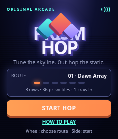
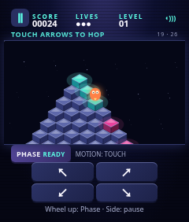
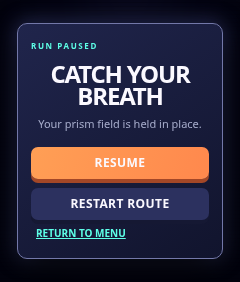
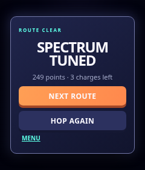

# Prism Hop

**Prism Hop** is an original isometric arcade game for the rabbit r1. Guide a bright hopper across expanded prism fields, tune every tile, evade Static Crawlers, and use a short Phase Ring at the right moment.



## The upgrade

The playable fields now begin at **8 rows / 36 prism tiles** and end at **11 rows / 66 tiles**. The original release ranged from 4 rows / 10 tiles to 7 rows / 28 tiles. Tiles are smaller in world space, while a clamped chase camera scrolls through the expanded field and keeps the hopper roughly centered during travel. The apex and field edges remain bounded, so the camera does not show beyond the course.

The presentation has been rebuilt for the 240×282 R1 viewport: faceted, glowing prism tiles; parallax-like starfield depth; richer crystal hopper and crawler silhouettes; and a compact high-contrast HUD. It remains procedural and has no external runtime dependencies.



## Play

- **Goal:** tune every prism tile in the selected route. A tuned tile stays cyan.
- **Tilt:** R1 accelerometer input is the primary four-direction diagonal hop control. Each run takes five valid samples to calibrate a neutral position, applies smoothing and a dead zone, and ignores stale readings. A sustained, deliberate tilt repeats at the current route tempo.
- **Wheel:** on the menu, scroll up/down to choose an unlocked route. During play, **wheel up** activates the three-second Phase Ring (seven-second recharge), which protects the hopper and displaces crawlers.
- **Side button:** starts from the menu and pauses/resumes a run.
- **Sound:** the speaker control mutes or enables original procedural hop, Phase Ring, collision, menu, start, and route-clear cues. Audio is initialized only after interaction where the browser requires it.
- **Fallback controls:** the on-screen diagonal pads remain available, along with browser keys **1–4** for hops, **Up Arrow** for Phase Ring, **Space** for the side-button action, and mouse wheel simulation. They stay available until physical R1 tilt behavior has been play-tested.
- **Hazards:** leaving the field, landing on an unstable magenta prism without Phase Ring, or touching a Static Crawler costs one of three lives.

## Routes

Six original routes escalate from 8 to 11 rows while increasing crawlers, unstable prisms, and hop cadence: **Dawn Array**, **Mirror Steps**, **Signal Bloom**, **Night Relay**, **Prism Storm**, and **Aurora Apex**. Progress unlocks locally in browser storage and uses R1 Creation storage when it is available.

## R1 integration and validation scope

The game guards access to the documented `window.creationSensors.accelerometer` API and requests samples at 30 Hz. It also listens for documented `scrollUp`, `scrollDown`, and `sideClick` bridge events. The bridge remains optional, so the game functions in an ordinary browser.

Browser validation covered the menu, gameplay board, camera bounds, simulated motion calibration and repeated hop path, touch fallback, pause/resume, results, sound toggle behavior, and no page overflow at **240×282**. Browser-injected motion/wheel events validate page logic only; sensor polarity, actual accelerometer responsiveness, side-button and wheel delivery, physical touch ergonomics, audio level/latency, and performance still need a physical R1 playtest. See [validation notes](./docs/validation.md).





## Sound and assets

All art is original procedural canvas/CSS/SVG created for this project. Sound effects are generated with short Web Audio oscillator envelopes at runtime. There are no copied arcade assets, external artwork, samples, fonts, or third-party runtime dependencies.

## Testing

```sh
node --check game-core.js && node --check app.js
node test-core.js
python3 -m http.server 8765 --directory .
# in another terminal:
python3 test-browser.py
```

`test-core.js` checks deterministic route topology, enlarged board dimensions, camera bounds, movement, enemy paths, and progression. `test-browser.py` runs the app in a touch-enabled 240×282 Chromium viewport and writes the screenshots above.

## Install on R1

The installation QR below encodes the Rabbit Creations SDK metadata card in [`creation-card.json`](./creation-card.json). On an R1, open **Creations → Create → Add via QR code** and scan it from another screen.


Published Creation: [Rabbit-hosted Prism Hop](https://prism-hop-m95syj.intern.rabbitos.app/index.html) · [GitHub Pages mirror](https://geekthegreybeard.github.io/prism-hop/) · [metadata card](https://geekthegreybeard.github.io/prism-hop/creation-card.json).
